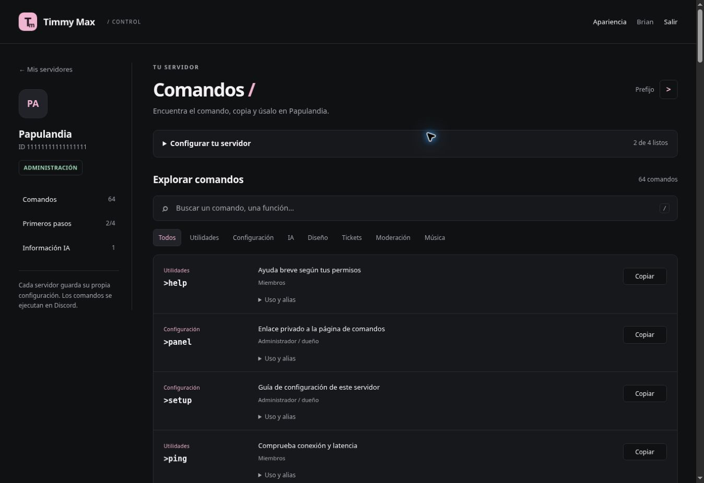
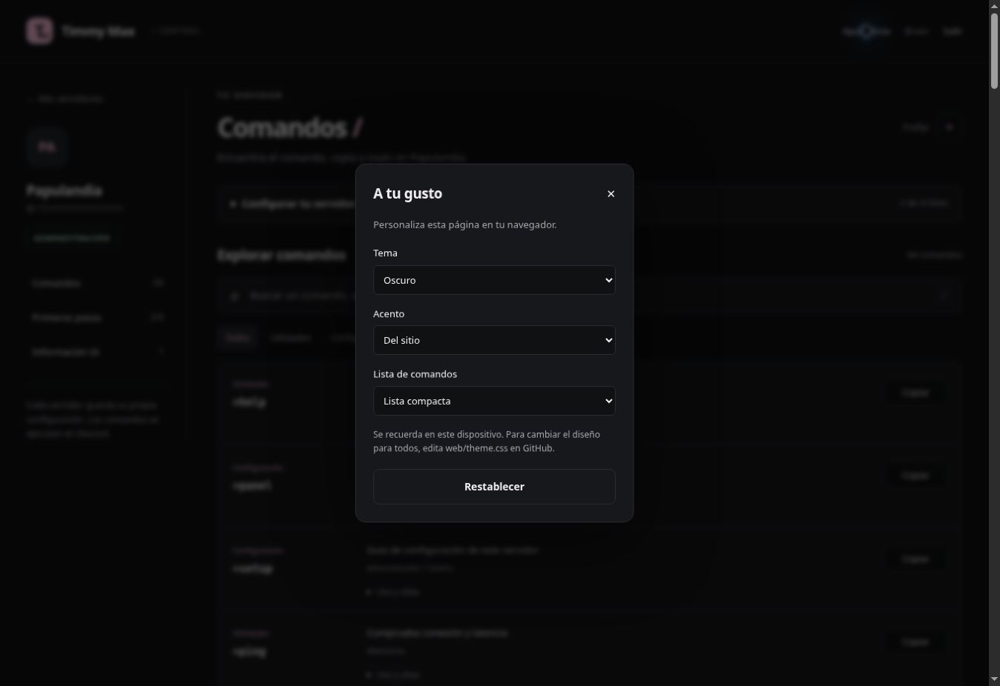

# Timmy Max v3.2 · Diseño a tu manera

Esta actualización añade plantillas de bienvenida/despedida, un editor de embeds en Discord, borradores con IA, diseños de tickets y apariencia personalizable de la web. Los ajustes pertenecen a cada servidor. La memoria sigue en `timmy-v3.json`.

## 1. Aplicar la actualización que ya está preparada

Si Railway ya está conectado a este repositorio y tu web funciona:

1. Abre el pull request de v3.2 en GitHub. En **Files changed** puedes revisar los cambios.
2. Pulsa **Merge pull request → Confirm merge** para integrarlo en `main`.
3. Abre Railway → servicio del bot → **Deployments**. Si tienes despliegues automáticos de `main`, aparecerá el nuevo despliegue. Si no, despliega el último commit de esa rama.
4. Conserva las variables actuales, el volumen montado en `/data` y una sola réplica. No necesitas borrar ni volver a subir la memoria.
5. Comprueba en los logs `Timmy Max v3.2 conectado`. Con `REGISTER_SLASH=true`, el inicio registra el catálogo de 64 comandos. Si `/embed` todavía no aparece, prueba `,embed` y vuelve a abrir Discord.
6. Prueba `,ping`. Entra en tu página y recarga con **Ctrl + Shift + R**.

No reemplaces solo `index.js`: esta actualización también usa `src/templates.js`, `src/studio.js`, `src/design-commands.js` y los archivos de `web/`. El pull request los mantiene en sus carpetas.

Para una instalación nueva, consulta [PAGINA_Y_ACTUALIZACION.md](PAGINA_Y_ACTUALIZACION.md). Esta actualización no requiere claves nuevas.

## 2. Quién configura cada cosa

- **Dueño del servidor o Administrador:** bienvenidas, despedidas, editor de embeds, anuncios con IA, ajustes y publicación de tickets, y página de comandos.
- **Miembro:** ayuda básica y apertura de su ticket desde el panel. No puede modificar diseños ni publicar anuncios con el bot.
- **Soporte:** atiende los tickets según el rol configurado y los permisos existentes.

El editor comprueba los permisos otra vez al pulsar sus botones. Solo la persona que creó el borrador puede editarlo o publicarlo. Los borradores duran 15 minutos y se pierden si el bot reinicia.

Se aceptan `,` y `>` además del prefijo configurado. En los ejemplos, selecciona el canal o rol real en Discord cuando escribas `#bienvenidas`, `#anuncios` o `@Soporte`.

## 3. Bienvenida como la referencia

Primero copia este ejemplo sin imagen para comprobar que funciona. Selecciona tu canal real al escribir `#bienvenidas`:

```text
,welcome add #bienvenidas {embed}$v{message: {user.mention}}$v{color: #f0b5d0}$v{description:
**welcome to {guild.name}**

Nos alegra tenerte aquí.
Lee las reglas y pasa al chat a saludar.
}$v{thumbnail: {user.avatar}}$v{footer: {guild.name} now has {guild.count} members}
```

Después:

```text
,welcome test #bienvenidas
,welcome edit #bienvenidas
```

**test** publica una muestra usando tu usuario. **edit** abre el editor: Texto y color, Autor, Pie, Imágenes y Código. Pulsa **Guardar diseño** para guardar los cambios; después puedes volver a hacer la prueba.

Para obtener exactamente la distribución de enlaces e imagen de tu ejemplo, cambia la descripción por:

```text
**welcome to {guild.name}**

[PSA](ENLACE_DEL_CANAL_PSA)
[Rules](ENLACE_DEL_CANAL_REGLAS)
[Chat](ENLACE_DEL_CANAL_CHAT)
```

Sustituye cada `ENLACE_...` por el enlace real de ese canal (clic derecho → Copiar enlace). Dentro de **Imágenes**, pega en **Imagen grande** el enlace directo al GIF o imagen y deja `{user.avatar}` en **Miniatura**. También puedes añadir al final del comando `$v{image: URL_REAL_DEL_GIF}`. Si una imagen deja de cargar, comprueba el enlace y vuelve a copiar uno válido; el bot no aloja las imágenes.

Otros controles:

| Comando | Resultado |
| --- | --- |
| `,welcome view #bienvenidas` | Descarga la plantilla editable en un archivo de texto. |
| `,welcome list` | Lista los canales configurados. |
| `,welcome remove #bienvenidas` | Quita la bienvenida de ese canal. |
| `,welcome off` | Desactiva todas las bienvenidas de ese servidor. |

Puedes configurar hasta 5 canales por tipo. Repetir `add` en el mismo canal reemplaza su plantilla. Los mensajes antiguos de texto siguen funcionando.

En Discord Developer Portal → Bot, **Server Members Intent** debe estar activo. El bot necesita Ver canal, Enviar mensajes e Insertar enlaces en el destino. Las bienvenidas pueden mencionar al miembro que entra; no notifican a `@everyone` ni a roles.

## 4. Despedida

```text
,goodbye add #despedidas {embed}$v{color: #aab3c5}$v{description:
**Hasta luego, {user.name}.**
Gracias por formar parte de {guild.name}.
}$v{thumbnail: {user.avatar}}$v{footer: Quedamos {guild.count} miembros}
```

```text
,goodbye test #despedidas
,goodbye edit #despedidas
```

También tiene `view`, `list`, `remove` y `off`. No hace falta borrar tus ajustes de bienvenida para usar despedidas.

## 5. Variables y formato de las plantillas

| Variable | Se sustituye por |
| --- | --- |
| `{user.mention}` | Mención del miembro. |
| `{user.name}` / `{user.username}` | Su nombre de usuario. |
| `{user.id}` | Su ID de Discord. |
| `{user.avatar}` | Su avatar. |
| `{guild.name}` | Nombre del servidor actual. |
| `{guild.id}` | ID del servidor actual. |
| `{guild.count}` | Cantidad de miembros. |
| `{guild.icon}` | Icono del servidor, si existe. |
| `{date.now}` | Fecha y hora UTC al generar el mensaje. |

Siguen disponibles `{user}`, `{username}`, `{server}` y `{count}` del formato anterior. En anuncios y pruebas se usa la persona que creó el borrador; en bienvenidas/despedidas se usa quien entra/sale. En un panel de tickets publicado, estas variables se resuelven con quien lo publica, no con cada visitante: usa `{guild.name}` para personalizarlo por comunidad.

Bloques admitidos:

```text
{embed}
$v{message: Texto fuera del embed}
$v{title: Título}
$v{description: Descripción con saltos de línea}
$v{color: #f0b5d0}
$v{thumbnail: {user.avatar}}
$v{image: URL_REAL_DE_IMAGEN}
$v{footer: Texto del pie}
$v{author: Nombre && URL_REAL_DEL_ICONO && https://example.com}
$v{field: Nombre del campo && Valor del campo && true}
$v{button: Abrir enlace && https://example.com && 🔗}
$v{timestamp: true}
```

Los bloques son opcionales. Reemplaza o elimina los que contienen `URL_REAL...`. Usa otro `$v{embed}` para empezar un segundo embed. Puedes usar hasta 3 embeds y 5 botones de enlace. No se ejecuta código JavaScript; es un formato de texto con propiedades conocidas. No es compatibilidad con todas las funciones de Bleed. Los botones de enlace abren su URL; no crean canales de voz.

Límites: mensaje externo 2000, título 256, descripción 4096, pie 2048, texto combinado de embeds 6000 caracteres. Discord puede limitar cuánto texto puedes enviar en un solo mensaje. El formulario **Código** admite hasta 4000 caracteres; **Exportar código** sirve para conservar plantillas más largas. Las llaves deben quedar equilibradas. Los emojis personalizados deben existir y ser accesibles al bot; usa su formato de Discord o un emoji normal como 🎫.

## 6. Crear un embed sin IA

```text
,ce #anuncios {embed}$v{title: Noche de juegos}$v{description:
Hoy nos vemos en el canal de voz.
Trae a tus amigos y elige el juego.
}$v{color: #f0b5d0}$v{footer: {guild.name}}
```

`ce` es un alias de `embed`. Si omites el canal, se elige el canal actual.

1. El bot muestra el canal de destino y el borrador.
2. Usa los botones para cambiar textos, color, autor, pie e imágenes.
3. Con varios embeds, elige cuál editar en el menú.
4. **Código** permite añadir campos, enlaces y otros embeds con el formato anterior.
5. **Publicar** envía el resultado al canal indicado; **Cancelar** descarta el borrador.

La vista previa no notifica menciones. Para notificar a todos, activa **@everyone: sí** y después pulsa **Publicar**. Tú y el bot deben tener Mencionar a todos en el destino. Las menciones individuales y de roles no hacen ping en este editor.

Con prefijo, el borrador se ve en el canal donde ejecutaste el comando: úsalo en un canal de staff si lo quieres privado. `/embed` y `/embedai` muestran el editor de forma privada. Si usas `/ask` para pedir un embed, su respuesta sigue la visibilidad de `/ask`; para un borrador privado, usa `/embedai`.

## 7. Pedírselo a la IA

```text
,embedai #anuncios Crea un anuncio pequeño y elegante para avisar que xKhopz está en directo en Kick con cámara encendida. Usa verde y un botón Ver stream con https://kick.com/xkhopz
```

También se reconoce:

```text
,ask haz un lindo embed para #anuncios anunciando una noche de juegos hoy a las 8. Color rosa y texto corto.
```

Debe empezar con `haz`, `crea`, `crear`, `diseña`, `genera` o `redacta` y mencionar `embed` cerca del inicio. Para evitar dudas usa `embedai`.

La primera mención de canal en tu petición elige el destino. La IA redacta; no envía nada por sí misma. Revisa el texto y el canal en el borrador y pulsa **Publicar**. Para cambiar una frase, usa **Texto y color**; para una nueva propuesta, ejecuta de nuevo `embedai`. Esta versión no modifica el borrador mediante una conversación posterior.

Necesita `GEMINI_API_KEY`, un `GEMINI_MODEL` disponible para tu clave y la IA activada en ese servidor (`>aiconfig on`). No necesita otras claves. La petición de diseño se envía a Gemini sin el historial del chat ni la información de otros servidores.

## 8. Panel de tickets personalizado

Si ya tienes configurados la categoría y el rol de soporte, puedes conservarlos. Si empiezas de cero:

1. Crea en Discord una **categoría** llamada TICKETS y un rol Soporte.
2. Activa Modo desarrollador en Discord → Ajustes de usuario → Avanzado.
3. Clic derecho en el título de la categoría TICKETS → Copiar ID. Es el contenedor de canales, no el ID de `#admin-chat` ni el de un usuario.
4. Ejecuta, sustituyendo `ID_CATEGORIA` por ese número y seleccionando el rol real:

```text
,ticketsetup ID_CATEGORIA @Soporte
```

Personaliza las opciones; puedes renombrar las 4 predeterminadas usando sus mismas claves:

```text
,ticketoption add soporte "Preguntas" "❔" "¿En qué podemos ayudarte?"
,ticketoption add reporte "Reportar" "📩" "Describe lo sucedido"
,ticketoption add recompensa "Alianzas" "🤝" "¿Qué comunidad representas?"
,ticketoption add postulacion "Aplicar a staff" "🎀" "Cuéntanos tu experiencia"
,ticketstyle buttons
```

Para un desplegable usa `,ticketstyle menu`. Máximo 5 opciones. La clave identifica la opción: repetirla la actualiza. `,ticketoption list` muestra las claves; `remove clave` elimina una y `reset` restaura las 4 predeterminadas. Usa `"-"` si no quieres emoji. Etiquetas y preguntas: máximo 45 caracteres cada una.

Diseña el panel con uno o varios embeds:

```text
,ticketdesign {embed}$v{title: 🎫 Open a Ticket}$v{color: #f0b5d0}$v{embed}$v{description:
🎀 Aplicar a staff
📩 Reportar
🤝 Alianzas
❔ Preguntas
}$v{color: #f0b5d0}$v{embed}$v{description: Elige el motivo de tu ticket. Nuestro equipo te ayudará.}$v{footer: {guild.name}}
```

Pulsa **Guardar diseño**. Para añadir el GIF decorativo, abre `,ticketdesign` sin argumentos, selecciona el embed central y usa **Imágenes**. Pega una URL real y guarda.

Finalmente ve al canal donde tus miembros abrirán tickets y escribe:

```text
,ticketpanel
```

Los botones o el menú para abrir tickets se añaden automáticamente. Los miembros podrán abrir su ticket; no podrán editar la configuración. `,ticketdesign reset` restaura el aspecto predeterminado.

Los paneles ya publicados no se redibujan automáticamente. Cuando cambies el diseño o las opciones, vuelve a publicar el panel y retira manualmente el mensaje anterior si ya no lo necesitas. Conserva los tickets abiertos: no hace falta borrar sus canales.

## 9. Personalizar la página

La web sigue usando tu dominio y el acceso de Discord existente. Los comandos y ajustes se ejecutan en Discord; la página presenta el catálogo y su estado.

### Cambiar tu vista sin tocar código

1. Entra en tu página y selecciona tu servidor.
2. Pulsa **Apariencia**, arriba.
3. Elige **Oscuro / Claro**, el acento y **Lista compacta / Tarjetas**.
4. Cierra la ventana. Se recuerda en ese navegador. **Restablecer** vuelve al diseño predeterminado.

Esto cambia tu vista. No modifica la configuración de otros administradores ni la de Discord.

### Cambiar el diseño predeterminado para todos

| Archivo de GitHub | Qué puedes editar |
| --- | --- |
| `web/theme.css` | Colores del sitio: fondo, superficies, texto y acento. Es el lugar más sencillo para empezar. |
| `web/style.css` | Tamaños, espacios, bordes, ancho de columnas y distribución. |
| `src/web.js` | Textos de la página, títulos y estructura HTML. |
| `web/app.js` | Búsqueda, copia y preferencias de apariencia. |
| `index.js` y `src/design-commands.js` | Nombres, descripciones y usos de los comandos del catálogo. |

Ejemplo: para un acento azul suave, en la primera regla `:root` de `web/theme.css` cambia `--accent:#f0b5d0` por `--accent:#9dcaff`. Cambia también la variante clara si quieres definir su acento azul, con un tono más oscuro para que se lea sobre blanco.

Paso a paso:

1. GitHub → este repositorio → carpeta **web** → **theme.css**.
2. Pulsa el lápiz **Edit this file**.
3. Cambia únicamente el valor que quieras, sin quitar el `;` ni las llaves.
4. Pulsa **Commit changes** y guarda el cambio en `main` (o usa otra rama si quieres revisarlo antes).
5. Espera el despliegue del nuevo commit en Railway.
6. Recarga la web con **Ctrl + Shift + R**. En Apariencia elige el acento **Del sitio** o pulsa **Restablecer** para ver tu nuevo color predeterminado.

No hace falta editar credenciales, la memoria ni OAuth para cambiar colores. Los iconos de los servidores se obtienen de Discord; si no tienen uno, se usan sus iniciales. El logo de Timmy del encabezado está en `layout()` de `src/web.js` y su aspecto en `.mark` dentro de `web/style.css`.

### Vistas de referencia

Estas capturas usan datos ficticios de Papulandia, no una sesión real de producción.





## 10. Comprobación al terminar

- `,welcome test #bienvenidas` y `,goodbye test #despedidas` muestran tu diseño.
- Un miembro normal no puede usar `ticketdesign`, `welcome add`, `ce` ni `embedai`.
- `,ce` muestra un borrador; solo publica al pulsar Publicar.
- El panel de tickets tiene tus opciones y abre un formulario con tu pregunta.
- El servidor B conserva sus propios ajustes aunque cambies el servidor A.
- Tras reiniciar Railway, siguen los diseños guardados (volumen `/data` conectado).

Las pruebas locales están descritas en [VALIDACION.md](VALIDACION.md). La comprobación final de envío, eventos de miembros y Gemini se hace en tu Discord después del despliegue.
